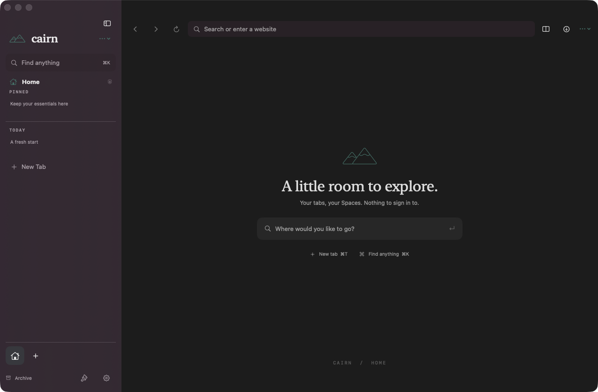
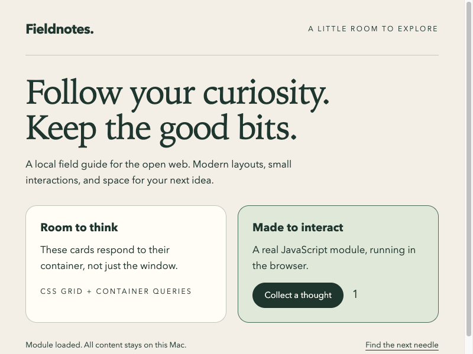

# Cairn

An experimental, local-first macOS browser with a vertical workspace: Spaces,
pinned tabs, favorites, a command bar, split browsing and per-site customization.
No Cairn account, login gate or telemetry.

Cairn is an original implementation, not a fork or recompiled version of Arc.
It is not affiliated with The Browser Company. **Do not treat this early project
as a hardened replacement for a maintained mainstream browser.**

[Product site](https://mrashrhodes.github.io/cairn/) ·
[Downloads](https://github.com/MrAshRhodes/cairn/releases/latest) ·
[Release guide](docs/RELEASING.md)



*Actual Cairn welcome-screen capture, not a mockup.*

## Install the developer preview

For macOS 14+, on Apple Silicon or Intel:

```sh
brew install --cask mrashrhodes/cairn/cairn
```

The [Homebrew tap](https://github.com/MrAshRhodes/homebrew-cairn) tracks published
release archives. You can also download the ZIP or DMG from
[GitHub Releases](https://github.com/MrAshRhodes/cairn/releases/latest).

**The published v0.1.0 preview uses WebKit, not Chromium.** It is universal,
ad-hoc signed and not Apple-notarized; macOS may block it. Do not disable system
security protections to run it. Sparkle authenticates its update archive and feed,
which is separate from Apple Developer ID signing.

## Build on your Mac

Requires macOS 14 or later, Swift 6, and Apple's Command Line Tools or Xcode.
The first build downloads Sparkle through Swift Package Manager. Local builds use
**Chromium (CEF)** exclusively for website compatibility, so they also
require CMake 3.21+ and Python 3.12+ (or a Python version with
`tarfile.data_filter`). Read the [CEF security status](docs/UPDATING_CHROMIUM.md)
before preparing its substantial native dependency:

```sh
git clone https://github.com/mrashrhodes/cairn.git
cd cairn
make app    # or `make run` to build and open it
```

`make build`, `make test`, `make app` and `make run` prepare CEF automatically:
the first run downloads and verifies the pinned archive (about 130 MB) and builds
its wrapper for your Mac's architecture; later runs reuse the verified cache.
The generated `dist/Cairn.app` bundles **Chromium and its matching helper processes**.
Both architecture records include SHA-256 pins derived from archives checked
against the publisher's size and SHA-1. This detects later changes to those bytes;
it is not independent publisher authentication.
There is no engine selector or WebKit fallback. Older settings files remain
readable, but their engine choice is ignored. Website cookies and storage from
older WebKit builds are not migrated into Chromium profiles.

CEF must run from a proper application bundle, so `make run` launches
`dist/Cairn.app` rather than an unbundled `swift run`. `scripts/bundle-app.sh`
packages Chromium once `make cef` has prepared the engine. Build separately for
Apple Silicon (`arm64`) and Intel (`x86_64`); universal builds are not supported.

A development build is
ad-hoc signed unless you configure your own Developer ID signing. Ad-hoc signing
is not notarization; see the [release guide](docs/RELEASING.md) before distributing
downloads.

## Developer preview status

The implementation includes native Spaces, vertical tabs,
favorites and pins, session restoration and archiving, a command bar with site
search and a remappable keyboard map (with an Arc-compatible preset), split
browsing with up to four panes, find/zoom, local history, downloads, and CSS/JavaScript
Boosts with an explicit trust decision. Newer pieces: sidebar folders and Space themes, a consent-based
importer for Chromium-family browsers ([docs](docs/features/import.md)), a visual Boost
editor with Zap and `.cairnboost` sharing ([docs](docs/features/boosts.md)), and link
routing rules ([docs](docs/features/links.md); Peek overlay and quick window are not built
yet). Developer Tools, view source, printing / Save Page as PDF and per-site zoom are
available through the menus and command bar, with remappable shortcuts.
Downloads started by a page, including **Download Linked File** and **Save Image As…**
in its context menu, are performed by Chromium
itself, so the page's cookies, sign-in, POST body and `blob:` sources are kept; Cairn
asks where to save, shows progress, and supports pause, resume and cancel. Only links
pasted into the Downloads sheet use Cairn's separate URL-based downloader, which sends no
website cookies.

Chromium integration also includes gesture-gated popups with opener/context
preservation, site permission and JavaScript dialog prompts, HTTP authentication,
fail-closed TLS handling, favicon and audio/mute state, DevTools, page source,
PDF export/viewing, per-site zoom and language/user-agent preferences. Renderer
crashes and stalled navigation have visible recovery states; startup and shutdown
have bounded deadlines. These are implemented capabilities, not a claim of full
Arc feature parity or production readiness.

Automated tests cover the integrated services and legacy settings compatibility.
[Recorded local arm64 checks](docs/UPDATING_CHROMIUM.md#updating-and-verification)
with the committed CEF 154 pin passed native rendering checks for CSS
grid, container queries, `:has()`, JavaScript modules, network requests, responsive
viewport resizing, and compositor output, alongside profile isolation and lifecycle
checks. The combined engine smoke also exercises popup messaging, permission/dialog
denials, authenticated/POST/blob downloads, crash recovery, media, PDF export and
page tools, but it is currently intermittent
([#31](https://github.com/MrAshRhodes/cairn/issues/31)). These are local development
checks, not release-security certification or acceptance of a newer CEF build.



*Actual engine compositor output. This is a local rendering fixture, not the full
Cairn shell or a claim that every website works.*

Full interactive Chromium browsing acceptance, VoiceOver, Intel CEF runtime
testing on native Intel hardware, Apple Developer ID signing and notarization
remain **unverified**. Cross-building or running under Rosetta does not close the
native Intel gate, and a configured CI matrix is not a passing run.
Camera/microphone approvals, native print/save panels, real-world sign-in flows,
long-running sessions and website compatibility still require hands-on acceptance.
Native print and save-panel integration is implemented; these interactions are
unverified, not missing APIs. Explicit tab/app close currently bypasses a page's
`beforeunload` cancellation and can lose unsaved work:
[issue #22](https://github.com/MrAshRhodes/cairn/issues/22) blocks a public Chromium
release, including one labelled a preview.
See the [release-readiness boundaries](docs/reference/functional-spec.md#release-readiness-boundaries)
and [release gates](docs/RELEASING.md#public-chromium-release-gates)
for the remaining feature and validation limits. Historical local smoke results
are not acceptance of a newer CEF pin or the final downloaded application.
Private update-signing material remains in the maintainer's local Keychain, not
GitHub. The weekly release workflow is wired but cannot publish until CI signing
is explicitly provisioned; see the [release guide](docs/RELEASING.md#weekly-release-automation).

The build wrapper handles the Command Line Tools-only SwiftPM/Swift Testing
configuration. It does not install or change your system toolchain.

## Engine and security updates

**Chromium Embedded Framework (CEF)** is the only engine for source builds and
future public releases. It remains **experimental**: it
has separate dependency, helper-process, packaging and security requirements, and
it is not updated by installing Google Chrome. Follow the [Chromium maintenance guide](docs/UPDATING_CHROMIUM.md);
do not enable an old CEF build just because it compiles. A version-monitoring
workflow cannot guarantee upstream fixes exist or ship them without a release.
The committed pin still trails Chrome stable; see the guide's dated comparison. The
newest stable CEF was tried locally but is not adopted because it failed the runtime
smoke ([#32](https://github.com/MrAshRhodes/cairn/issues/32)). Even closing the
version gap would not close the other public Chromium release gates.

The historical v0.1.0 download uses **system WebKit**, updated by Apple through
macOS/Safari updates. This does not describe the current source or future releases.
Keep macOS and its browser components current.

Application auto-updates require signed Sparkle releases and the matching public
key embedded in the installed application. An unconfigured source build must
not accept unsigned updates.

## Make it yours

Use local CSS/JavaScript Boosts for site customization and modules for additional
commands. See [Extending Cairn](docs/EXTENDING.md). JavaScript customizations are
trusted page code, not sandboxed Chrome extensions. Chrome extension support,
cloud synchronization, Arc account migration and DRM compatibility are not
promised.

## Product website

The dependency-free site in `site/` includes an interactive illustration of Spaces,
pins, vertical tabs, split view, and the command menu. Its fictional `.example`
pages are rendered locally, not fetched from the web. It is not the native app or
an embedded browser engine; preview state resets when the page reloads.

From the repository root, serve it locally:

```sh
python3 -m http.server 4173 --bind 127.0.0.1 --directory site
```

Open `http://127.0.0.1:4173`. Use Command/Ctrl+K for commands and arrow keys to
switch tabs. Download links and project information remain available without
JavaScript.

## Project guide

- [Functional specification and reference boundaries](docs/reference/functional-spec.md)
- Features: [command bar](docs/features/command-bar.md), [keyboard shortcuts](docs/features/shortcuts.md), [split view](docs/features/split-view.md)
- [Contributing and development invariants](CONTRIBUTING.md)
- [Privacy](PRIVACY.md) and [security policy](SECURITY.md)
- [Independent implementation policy](docs/CLEAN_ROOM.md)
- [Release and update signing](docs/RELEASING.md)
- [Chromium maintenance](docs/UPDATING_CHROMIUM.md)

Cairn's original code is licensed under [Apache-2.0](LICENSE). Third-party
components retain their own licenses; see [NOTICE](NOTICE).
